<div align="center">

<picture>
  <source media="(prefers-color-scheme: dark)" srcset="docs/assets/readme/hero-dark.webp">
  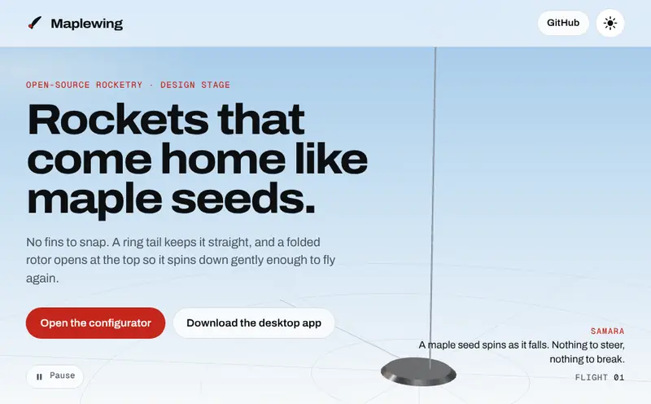
</picture>

# Maplewing

**Rockets that come home like maple seeds.**

Open-source model and high-power rockets with a printed ring tail instead of fins,<br>
and a folded rotor that opens at apogee and autorotates them back to the ground.

[](https://github.com/Normansrule/maplewing/actions/workflows/ci.yml)
[](https://normansrule.github.io/maplewing/)
[](https://github.com/Normansrule/maplewing/releases/latest)
[](LICENSES/MIT.txt)
[](LICENSES/CC-BY-SA-4.0.txt)

**[Website](https://normansrule.github.io/maplewing/)** ·
**[Live configurator](https://normansrule.github.io/maplewing/app/)** ·
**[Desktop app](https://github.com/Normansrule/maplewing/releases/latest)** ·
[Parts and STLs](#the-parts) ·
[Cost](#what-it-costs) ·
[Equations](#the-physics) ·
[Run it yourself](#run-it-yourself)

</div>

> [!IMPORTANT]
> **Design stage. Nothing here has flown yet.** Every number below is from the simulator or the CAD (computer-aided design) model, and each one says which. Flight and drop-test results will replace them as they come in. Only commercial, certified motors are used, and nothing is to be built, bought or flown on the strength of this page alone.

<br>

## At a glance

| | | |
|:--|:--|:--|
| **6** rocket configurations on one shared framework | **10** printable parts, each with an STL file and a mass budget | **$89.03** for the Seedling's first flying day, from listed retail prices |
| **263 m** simulated Seedling apogee on an Estes C6-5 | **4.4 m/s** simulated Seedling landing speed under its 0.30 m rotor | **2 ways** to use it: [in the browser](https://normansrule.github.io/maplewing/app/) or as a [desktop app](https://github.com/Normansrule/maplewing/releases/latest) |

<br>

## The idea

A maple seed (a *samara*) needs no parachute. It is heavy at one end and has one wing, so when it falls the wing catches the air, it starts to spin, and the spin slows it down. That is autorotation, and it is how a helicopter with a dead engine still lands.

Maplewing applies the same idea to a rocket:

1. **Ring tail instead of fins.** A printed ring around the motor end keeps the rocket pointing straight. Unlike fins, it has no thin edges to snap off on landing.
2. **Folded rotor.** Three balsa blades lie flat along the body tube on the way up. They are held at a fixed 6° pitch by printed hinge pads, so nothing can move them in flight.
3. **Opens at apogee.** The motor's own ejection charge pushes the nose off. The blades swing out on spring wire, the rotor starts to spin, and the rocket spins down at a steady speed to fly again.

<div align="center">
<table>
<tr>
<td align="center" width="33%">
<picture>
  <source media="(prefers-color-scheme: dark)" srcset="docs/assets/readme/seedling-folded-dark.png">
  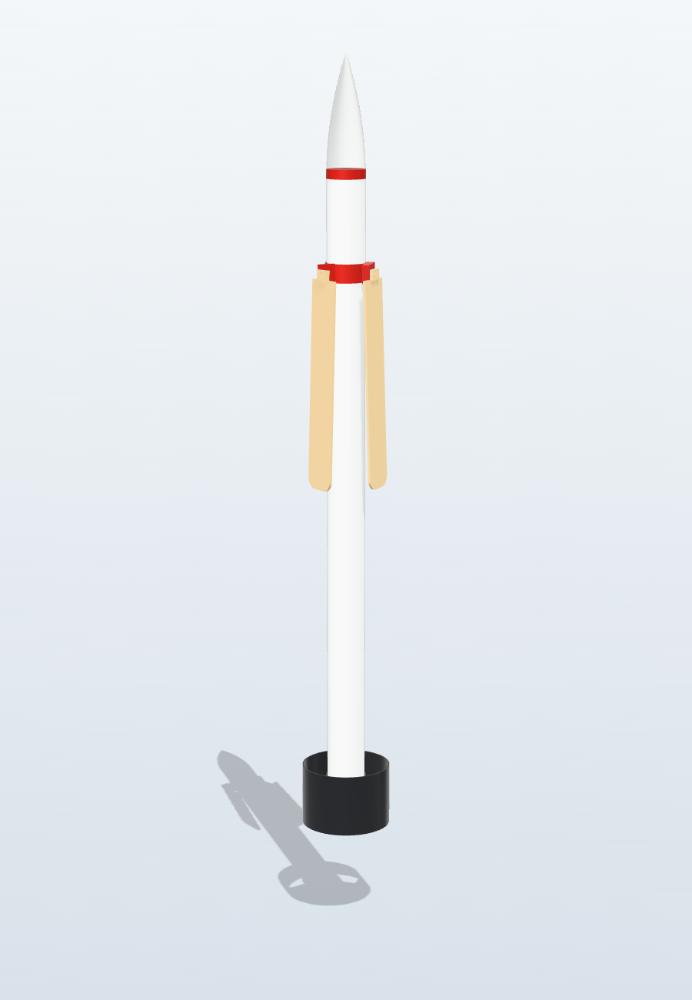
</picture>
<br><sub><b>Folded for boost</b></sub>
</td>
<td align="center" width="33%">
<picture>
  <source media="(prefers-color-scheme: dark)" srcset="docs/assets/readme/seedling-exploded-dark.png">
  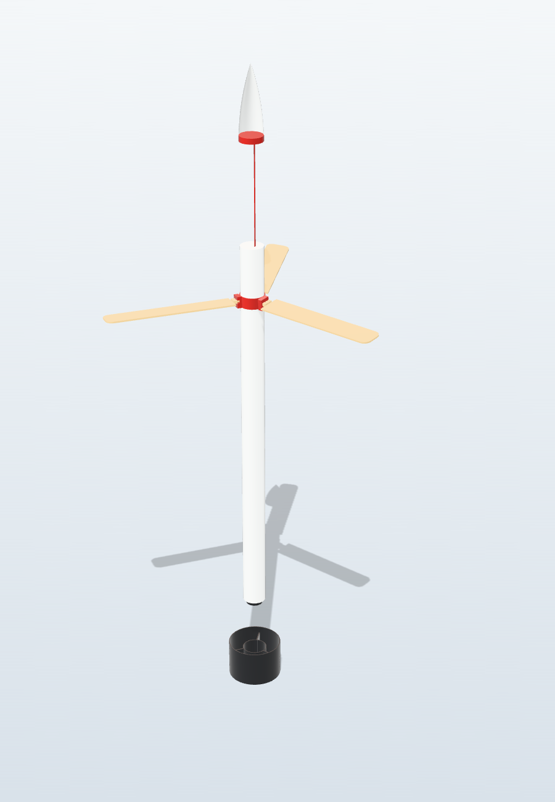
</picture>
<br><sub><b>Nose off, rotor open</b></sub>
</td>
<td align="center" width="33%">
<picture>
  <source media="(prefers-color-scheme: dark)" srcset="docs/assets/readme/dewdrop-assembly-dark.png">
  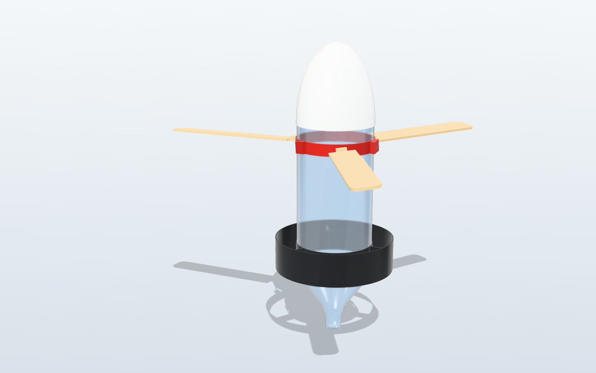
</picture>
<br><sub><b>Dewdrop, the water rocket</b></sub>
</td>
</tr>
</table>
</div>

All three pictures are rendered from the same STL files you can download below, by the same three.js code the website uses. Nothing is drawn by hand.

<br>

## The lineup

Every configuration shares one framework: the same ring tail, rotor hub and blade design, scaled to the body tube. The simulator flies each one with the real certified thrust curve from [ThrustCurve.org](https://www.thrustcurve.org).

| Rocket | Class | Motor | Body | Tail | Landing | Apogee | Top speed | Lands at | Status |
|:--|:--|:--|--:|:--|:--|--:|--:|--:|:--|
| **Taproot** | FAA Class 1 (model rocket) | Estes C6-5 | 25 mm | 3 fins | 0.30 m parachute | 376 m | 115 m/s | 2.8 m/s | 🟢 Ready to build |
| **Seedling** | FAA Class 1 (model rocket) | Estes C6-5 | 25 mm | Ring | 0.30 m rotor | 263 m | 75 m/s | 4.4 m/s | 🟢 Ready to build |
| **Dewdrop** | Water rocket (not an FAA rocket class) | Water and air | 105 mm | Ring | 0.44 m rotor | 40.8 m | 40.9 m/s | 4.2 m/s | 🟢 Ready to build |
| **Maplewing-1** | FAA Class 2 (high-power), Level 1 | AeroTech H128W | 57 mm | Ring | 0.88 m rotor | 455 m | 99 m/s | 6.5 m/s | 📐 CAD on paper |
| **Maplewing-1, L2 config** | FAA Class 2, Level 2 | AeroTech J350W | 102 mm | Ring | 1.40 m rotor | 763 m | 140 m/s | 6.5 m/s | 📐 CAD on paper |
| **Maplewing-2** | FAA Class 2, Level 3, two stages | O3400 then N5600 | 102 mm | Fins | 2.19 m and 2.17 m rotors | 33,238 m | 1,346 m/s | 6.5 m/s | 🧮 Simulation only |

<sub>FAA is the US Federal Aviation Administration. "Level 1/2/3" are the high-power certification levels from the National Association of Rocketry (NAR) and Tripoli Rocketry Association (TRA). Taproot is a stock Estes Alpha III, the control rocket that every ring-tail and rotor result has to beat. Data: <a href="sim/lineup.json"><code>sim/lineup.json</code></a>.</sub>

<picture>
  <source media="(prefers-color-scheme: dark)" srcset="docs/assets/readme/charts/apogee-dark.png">
  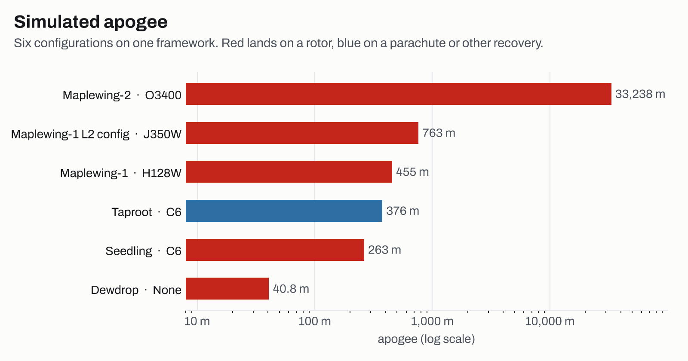
</picture>

<details>
<summary><b>The tiers: Seedling, Sapling, Canopy</b></summary>
<br>

| Tier | What it covers | In this repository |
|:--|:--|:--|
| **Seedling** | Model rockets and water rockets anyone can fly at a club launch: Taproot, Seedling, Dewdrop | Full CAD, parts list, costs and simulations |
| **Sapling** | High-power rockets that need NAR or TRA certification: Maplewing-1, Maplewing-2 | CAD on paper and simulations, nothing to fly yet |
| **Canopy** | The highest-altitude work | **Held for export-control review.** Not published here. |

</details>

<br>

## Why a rotor?

<picture>
  <source media="(prefers-color-scheme: dark)" srcset="docs/assets/readme/charts/descent-dark.png">
  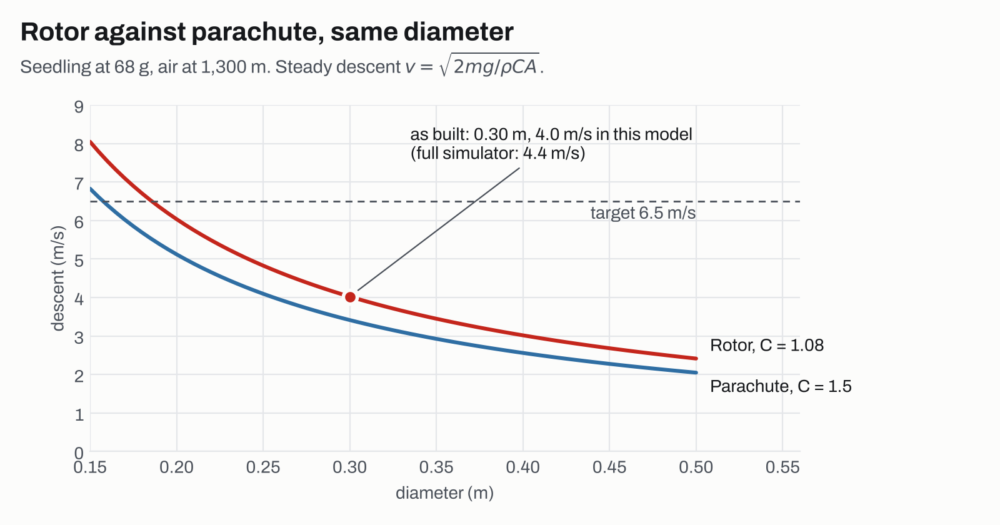
</picture>

To be honest about it: **at the same diameter, a parachute falls slower.** The blade-element model gives the Maplewing rotor an equivalent drag coefficient of 1.08, against about 1.5 for a round parachute. So why bother?

| | Rotor | Parachute |
|:--|:--|:--|
| **Descent at 0.30 m, Seedling** | 4.0 m/s (simple model), 4.4 m/s (full simulator) | 3.4 m/s |
| **Drift in wind** | Less, because it spends less time in the air | More |
| **Packing** | Blades fold flat along the tube; nothing to fold or tangle | Has to be folded, packed and protected from the ejection charge |
| **Damage on landing** | Rigid blades can break; balsa is cheap and quick to recut | Usually fine |

The rotor is sized to land at 6.5 m/s or slower, the same rule of thumb used for parachutes. The drop tests planned for Dewdrop and Seedling are what will show whether the 1.08 holds.

<br>

## The parts

Ten parts, all parametric in [`cad/maplewing_parts.py`](cad/maplewing_parts.py) (CadQuery). Click a name to download its STL, or open the [parts inspector](https://normansrule.github.io/maplewing/#parts) to spin each one in 3D.

<table>
<tr>
<td align="center" width="33%">
<picture><source media="(prefers-color-scheme: dark)" srcset="docs/assets/readme/parts/seedling_ring_tail-dark.png">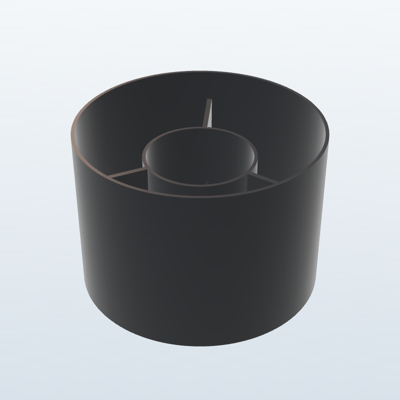</picture>
<br><b><a href="cad/stl/seedling_ring_tail.stl">Seedling · Ring tail</a></b>
<br><sub>PETG · ×1 · 11.1 g (budget 8 g) · 58 × 58 × 40 mm</sub>
</td>
<td align="center" width="33%">
<picture><source media="(prefers-color-scheme: dark)" srcset="docs/assets/readme/parts/seedling_rotor_hub-dark.png">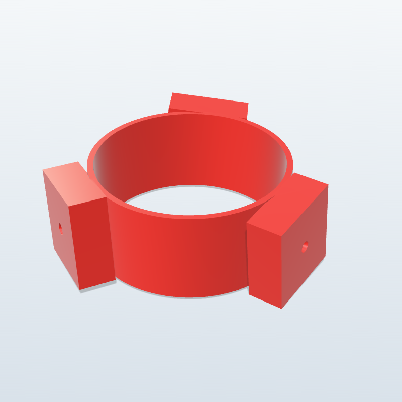</picture>
<br><b><a href="cad/stl/seedling_rotor_hub.stl">Seedling · Rotor hub</a></b>
<br><sub>PETG · ×1 · 3.4 g (budget 4 g) · 33 × 37 × 13 mm</sub>
</td>
<td align="center" width="33%">
<picture><source media="(prefers-color-scheme: dark)" srcset="docs/assets/readme/parts/seedling_rotor_blade-dark.png">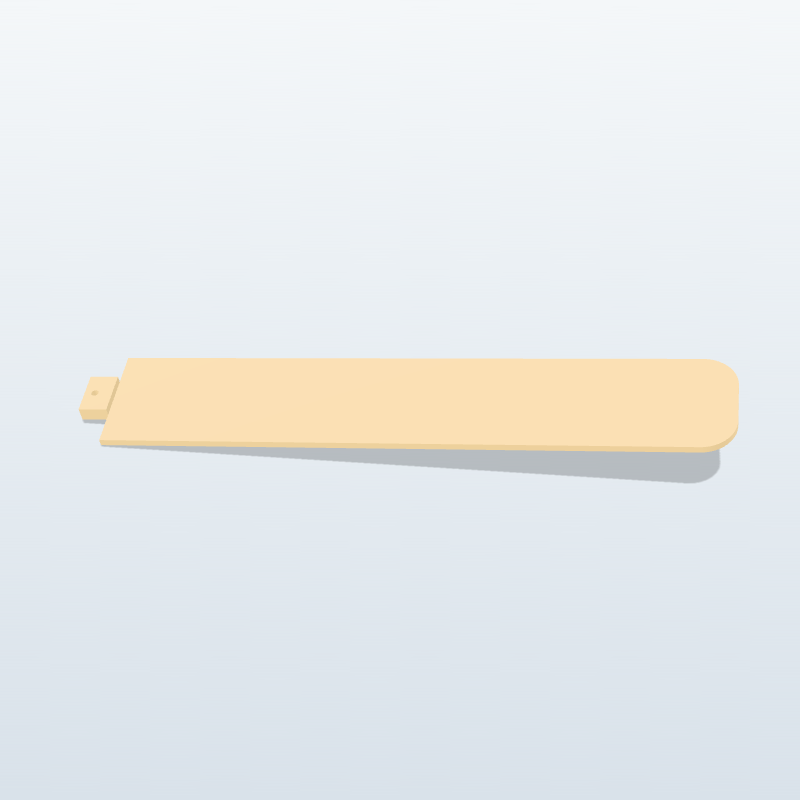</picture>
<br><b><a href="cad/stl/seedling_rotor_blade.stl">Seedling · Rotor blade</a></b>
<br><sub>Balsa 1/16 in · ×3 · 0.9 g (budget 2 g) · 141 × 25 × 3 mm</sub>
</td>
</tr>
<tr>
<td align="center">
<picture><source media="(prefers-color-scheme: dark)" srcset="docs/assets/readme/parts/dewdrop_ring_tail-dark.png">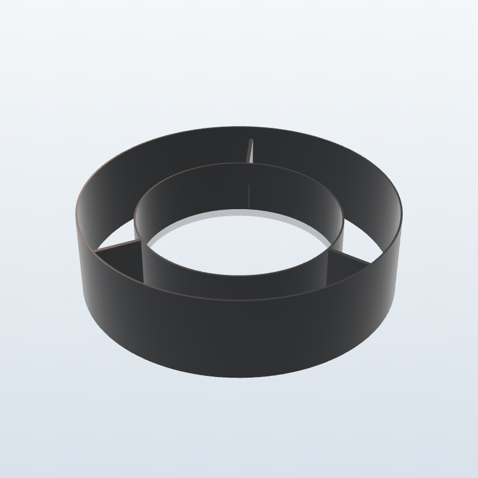</picture>
<br><b><a href="cad/stl/dewdrop_ring_tail.stl">Dewdrop · Ring tail</a></b>
<br><sub>PETG · ×1 · 48.5 g (budget 40 g) · 165 × 165 × 45 mm</sub>
</td>
<td align="center">
<picture><source media="(prefers-color-scheme: dark)" srcset="docs/assets/readme/parts/dewdrop_rotor_hub-dark.png">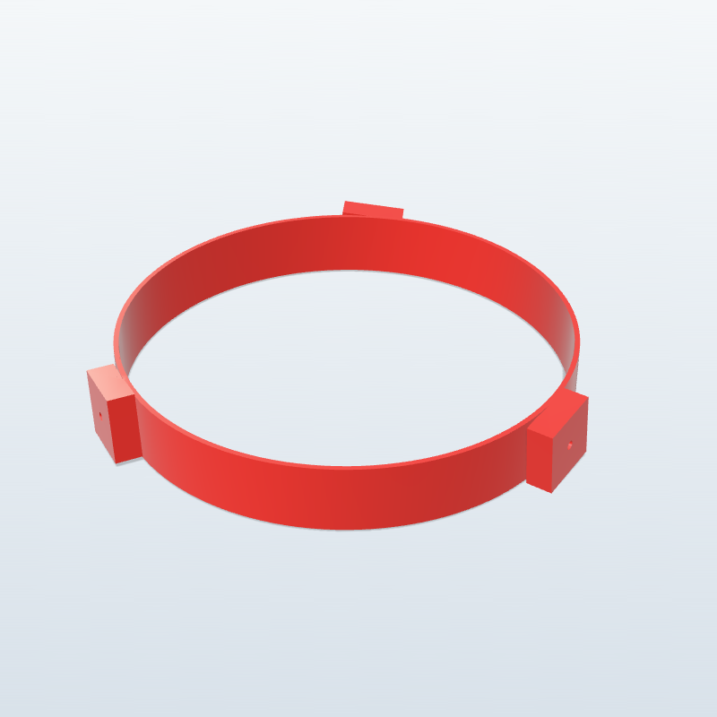</picture>
<br><b><a href="cad/stl/dewdrop_rotor_hub.stl">Dewdrop · Rotor hub</a></b>
<br><sub>PETG · ×1 · 14.0 g (budget 12 g) · 114 × 113 × 18 mm</sub>
</td>
<td align="center">
<picture><source media="(prefers-color-scheme: dark)" srcset="docs/assets/readme/parts/dewdrop_rotor_blade-dark.png">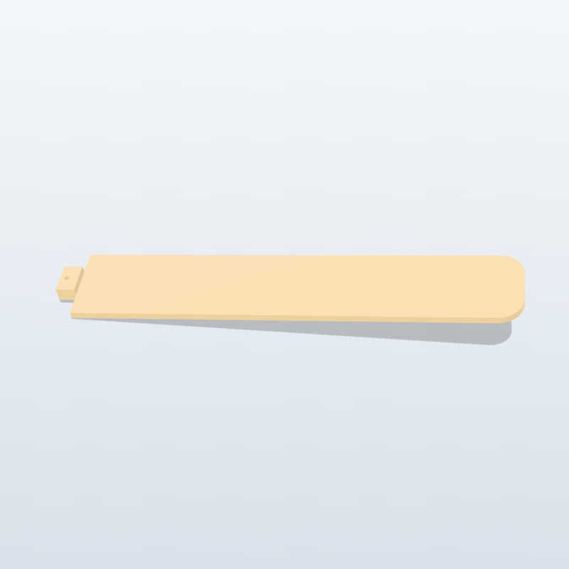</picture>
<br><b><a href="cad/stl/dewdrop_rotor_blade.stl">Dewdrop · Rotor blade</a></b>
<br><sub>Balsa 1/8 in · ×3 · 3.5 g (budget 6 g) · 198 × 35 × 6 mm</sub>
</td>
</tr>
<tr>
<td align="center">
<picture><source media="(prefers-color-scheme: dark)" srcset="docs/assets/readme/parts/dewdrop_nose_timer_bay-dark.png"></picture>
<br><b><a href="cad/stl/dewdrop_nose_timer_bay.stl">Dewdrop · Nose with timer bay</a></b>
<br><sub>PETG · ×1 · 36.7 g (budget 30 g) · 107 × 107 × 110 mm</sub>
</td>
<td align="center">
<picture><source media="(prefers-color-scheme: dark)" srcset="docs/assets/readme/parts/maplewing1_ring_tail-dark.png">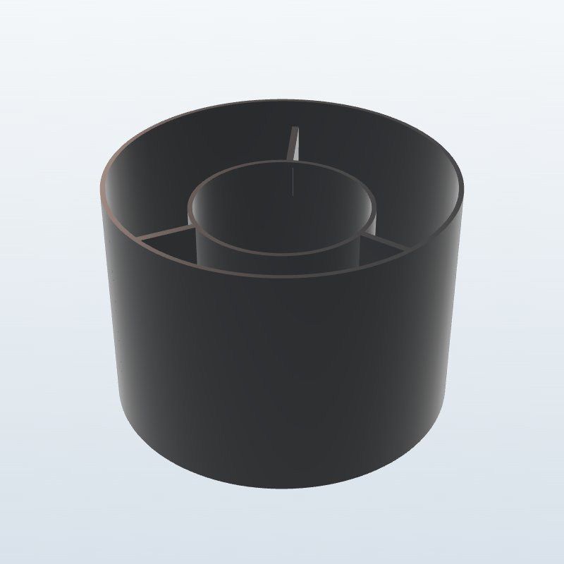</picture>
<br><b><a href="cad/stl/maplewing1_ring_tail.stl">Maplewing-1 · Ring tail</a></b> 📐
<br><sub>PETG · ×1 · 94.6 g (budget 250 g) · 115 × 115 × 80 mm</sub>
</td>
<td align="center">
<picture><source media="(prefers-color-scheme: dark)" srcset="docs/assets/readme/parts/maplewing1_rotor_hub-dark.png">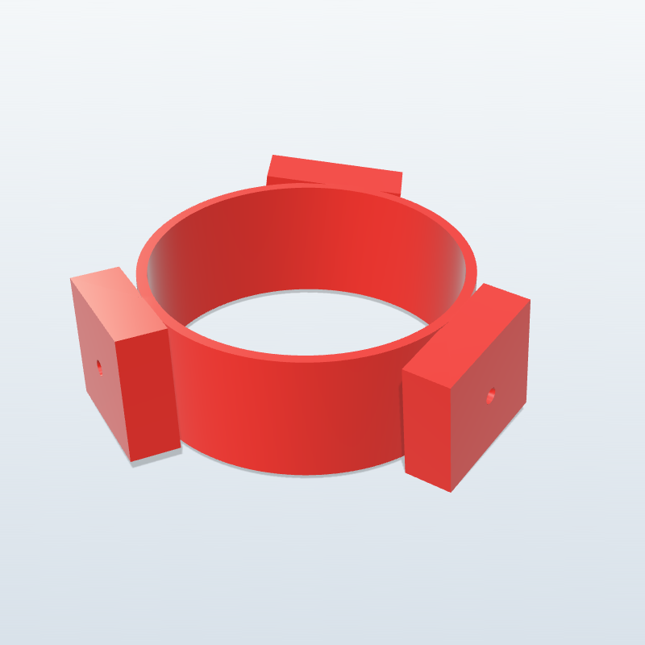</picture>
<br><b><a href="cad/stl/maplewing1_rotor_hub.stl">Maplewing-1 · Rotor hub</a></b> 📐
<br><sub>PETG · ×1 · 34.0 g (budget 60 g) · 74 × 84 × 27 mm</sub>
</td>
</tr>
<tr>
<td align="center">
<picture><source media="(prefers-color-scheme: dark)" srcset="docs/assets/readme/parts/maplewing1_rotor_blade-dark.png">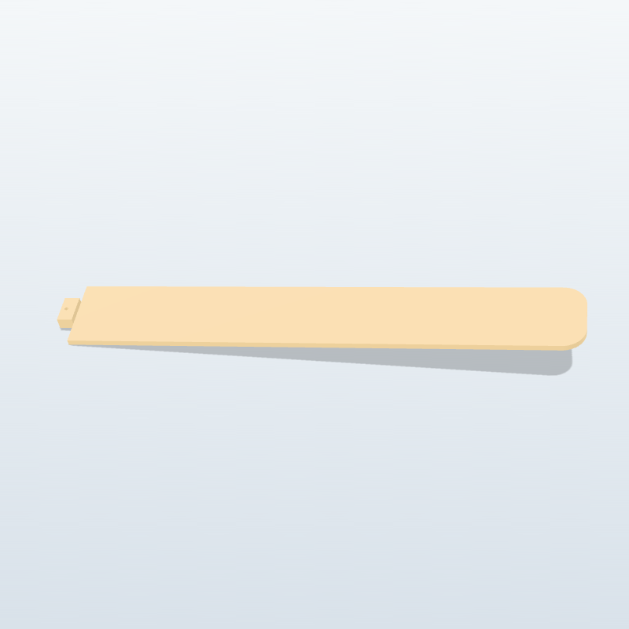</picture>
<br><b><a href="cad/stl/maplewing1_rotor_blade.stl">Maplewing-1 · Rotor blade</a></b> 📐
<br><sub>Balsa · ×3 · 18.8 g (budget 30 g) · 412 × 60 × 10 mm</sub>
</td>
<td align="center" colspan="2">
<picture><source media="(prefers-color-scheme: dark)" srcset="docs/assets/readme/seedling-assembly-dark.png">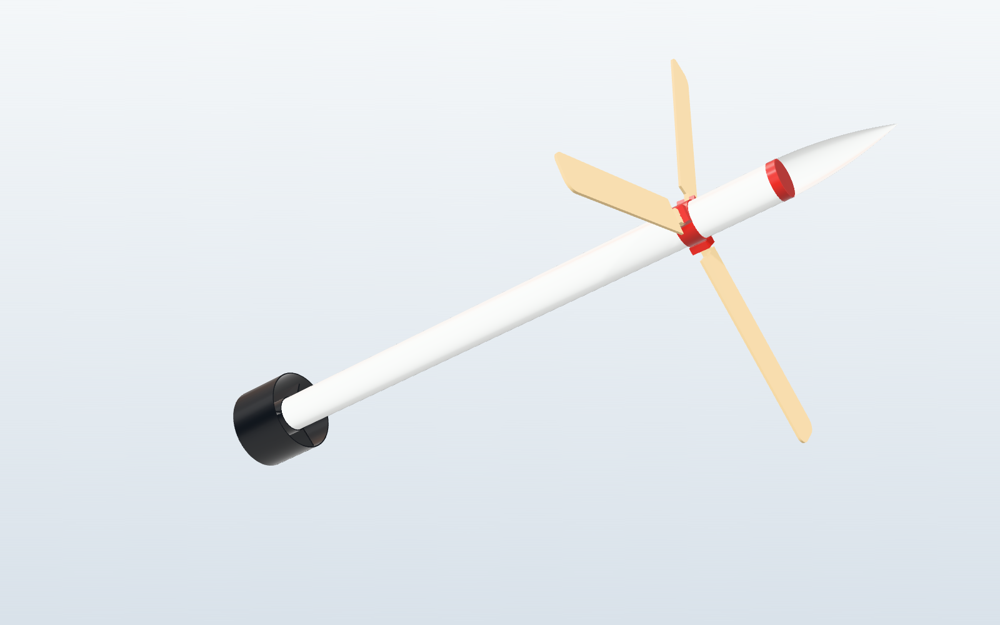</picture>
<br><b>Seedling, assembled</b>
<br><sub>Printed ring tail and hub, three balsa blades, BT-50 tube and nose</sub>
</td>
</tr>
</table>

<sub>📐 = paper only: print it to check fit, not to fly. Masses are from the CAD at solid PETG density (1.27 g/cm³) and balsa; weigh your prints. Data: <a href="cad/parts.json"><code>cad/parts.json</code></a>.</sub>

<picture>
  <source media="(prefers-color-scheme: dark)" srcset="docs/assets/readme/charts/mass-dark.png">
  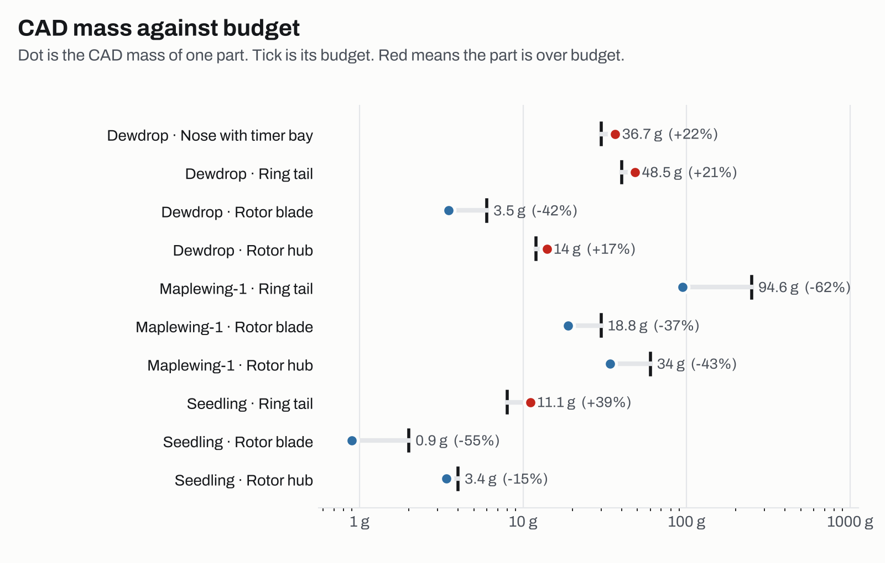
</picture>

Four printed parts are still over their mass budget. The first version of the CAD printed everything at 1.6 to 2 mm walls and came out 2.6 times over, so the walls are now 0.8 to 1.6 mm. The Seedling ring tail, at +39%, is next to slim down.

### Printing and building

- **Material.** PETG (polyethylene terephthalate glycol) for every printed part. It is tougher than PLA (polylactic acid) and keeps its shape on a hot launch field.
- **Measure first.** Body tubes and bottles vary. Measure yours and change `tube_od` or `bottle_od` in [`cad/maplewing_parts.py`](cad/maplewing_parts.py) before you print, then run `python cad/maplewing_parts.py` (needs [CadQuery](https://cadquery.readthedocs.io)) to regenerate the STLs and `cad/parts.json`.
- **Blades.** The blade STL is an outline. Print it on paper or trace it, and cut three blades from balsa sheet with the grain running along the blade.
- **Hinges.** 1/16 in (1.6 mm) music wire through the hub pads makes the hinge pins and the springs that swing the blades out.
- **Pitch is fixed.** The 6° pitch is printed into the hinge pads, so there is nothing to adjust and nothing that can move in flight.

<br>

## What it costs

Every price below is a retailer's listed price with a link, checked on 22 November 2026. Items marked *needs quote* are not counted in the totals, so the real totals are a little higher. Full list with sources: [`exports/bom/maplewing-bom.csv`](exports/bom/maplewing-bom.csv).

<picture>
  <source media="(prefers-color-scheme: dark)" srcset="docs/assets/readme/charts/cost-dark.png">
  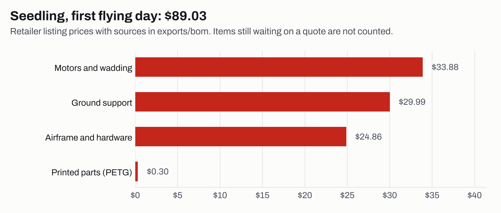
</picture>

<details open>
<summary><b>Seedling: $89.03 for the first flying day</b></summary>
<br>

| ID | Item | Price | Source | Status |
|:--|:--|--:|:--|:--|
| SDL-01 | Ring tail, printed (11.1 g PETG) | $0.23 | [PETG at $20.99/kg](https://www.th3dstudio.com/product/polymaker-polylite-petg-black-1kg-1-75mm/) | Filament |
| SDL-02 | Rotor hub, printed (3.4 g PETG) | $0.07 | [PETG at $20.99/kg](https://www.th3dstudio.com/product/polymaker-polylite-petg-black-1kg-1-75mm/) | Filament |
| SDL-03 | Balsa sheet 1/16 × 3 × 36 in (three blades) | $2.30 | [Balsa USA](https://balsausa.com/products/1-16-x-3-x-36-balsa-sheet) | Listed |
| SDL-04 | Music wire 1/16 in × 36 in (pins and springs) | $2.59 | [HobbyTown](https://www.hobbytown.com/k-s-engineering-music-wire-36.0621-16-15-ks5041/p204713) | Listed |
| SDL-05 | Estes BT-50 body tubes, 3-pack | $8.99 | [Sirius Rocketry](https://www.siriusrocketry.biz/ishop/estes-bt-50-body-tube-3-pack-678.html) | Listed |
| SDL-06 | Estes PNC-50KA nose cone | $2.99 | [eRockets](https://www.erockets.biz/estes-plastic-nose-cone-for-bt-50-tube-2-75-long-est-071028/) | Listed |
| SDL-07 | Estes 18 mm engine mount kit | $7.99 | [Sirius Rocketry](https://www.siriusrocketry.biz/ishop/estes-standard-18mm-engine-mount-kit-1923.html) | Listed |
| SDL-08 | Estes recovery wadding, 75 sheets | $5.99 | [AC Supply](https://www.acsupplyco.com/estes-recovery-wadding) | Listed |
| SDL-09 | Estes B6-4 motors, 3-pack | $13.90 | [Apogee Components](https://www.apogeerockets.com/index.php?main_page=product_info&products_id=12) | Listed |
| SDL-10 | Estes C6-5 motors, 3-pack | $13.99 | [Estes, configurator check](https://www.thrustcurve.org/motors/Estes/C6/) | Listed |
| SDL-11 | Estes Porta-Pad II and launch controller | $29.99 | [Micromark](https://micromark.com/products/estes-porta-pad-ii-launch-pad-and-electron-beam-launch-controller) | Listed |
| SDL-12 | Shock cord and 1.22 m launch rod | — |  | Needs quote |
| | **Total** | **$89.03** | | |

</details>

<details>
<summary><b>Taproot: $64.97</b></summary>
<br>

| ID | Item | Price | Status |
|:--|:--|--:|:--|
| TAP-01 | Estes Alpha III launch set (rocket, pad, controller) | $39.99 | Verified |
| TAP-02 | Estes recovery wadding, 75 sheets | $5.99 | Verified |
| TAP-03 | Estes C6-5 motors, 3-pack | $13.99 | Verified |
| TAP-04 | AA batteries for the controller (4) | $5.00 | Estimate |
| | **Total** | **$64.97** | |

</details>

<details>
<summary><b>Dewdrop: $45.00 plus a timer and pump</b></summary>
<br>

| ID | Item | Price | Status |
|:--|:--|--:|:--|
| DEW-01 | Ring tail sleeve, printed (48.5 g PETG) | $1.02 | Filament |
| DEW-02 | Rotor hub, printed (14.0 g PETG) | $0.29 | Filament |
| DEW-03 | Nose with timer bay, printed (36.7 g PETG) | $0.77 | Filament |
| DEW-04 | Balsa sheet 1/8 × 3 × 36 in | $3.42 | Listed |
| DEW-05 | 2 L PET soda bottle | $0.00 | Reused |
| DEW-06 | AquaPod bottle rocket launcher | $39.50 | Listed |
| DEW-07 | Wind-up release timer and bicycle pump with gauge | — | Needs quote |
| | **Total** | **$45.00** | |

The AquaPod's relief valve opens at 45 psi, so on that launcher Dewdrop reaches about 33 m rather than the 41 m simulated at full pressure.

</details>

<details>
<summary><b>Maplewing-1: one verified price so far</b></summary>
<br>

| ID | Item | Price | Status |
|:--|:--|--:|:--|
| MW1-01 | AeroTech H128W-14A RMS-29/180 reload | $39.49 | Verified |
| MW1-02 | 54 mm airframe, RMS-29/180 case, two commercial altimeters, rotor hardware | — | Needs quote |

</details>

<sub><b>Verified</b> means confirmed against the seller's page. <b>Listed</b> means the retailer's listed price on the date checked, with the link given; check it again before you buy. <b>Filament</b> is the CAD mass times the PETG price per gram.</sub>

<br>

## The physics

The simulator ([`sim/maplewing_framework.py`](sim/maplewing_framework.py)) and the browser configurator run the same equations, and a test ([`sim/test_py_js_agree.py`](sim/test_py_js_agree.py)) fails if they ever disagree. These are the core ones. All of them, with every assumption labelled, are in [`notes/EQUATIONS.md`](notes/EQUATIONS.md).

**Flight.** Explicit Euler at 5 ms steps, with the certified thrust curve $F(t)$ and Mach-dependent drag:

$$m\,\dot v = F(t) - D - m\,g(z), \qquad D = \tfrac12\,\rho\,v^2\,C_D\,C_M(M)\,\frac{\pi d^2}{4}$$

**Landing size.** A rotor or parachute treated as an equivalent drag disc of diameter $D$:

$$v = \sqrt{\frac{2 m g}{\rho\,C\,\pi D^2/4}} \qquad\Longleftrightarrow\qquad D = \sqrt{\frac{8 m g}{\pi\rho\,C\,v^2}}$$

with $C = 1.08$ for the Maplewing rotor at 6° pitch and $C = 1.5$ for a round parachute.

**Rotor.** Blade-element autorotation. For each blade element at radius $r$ spinning at $\Omega$:

$$\phi = \operatorname{atan2}(V - v_i,\ \Omega r), \qquad \alpha = \theta + \phi, \qquad dQ = N\,q\,c\,dr\,(C_l\sin\phi - C_d\cos\phi)\,r$$

The rotor settles at the spin rate where the torque $Q(\Omega) = 0$, and the descent speed is the one where thrust equals weight. Sweeping the pitch gave 6° as the best fixed pitch.

**Stability.** Barrowman's method for the nose and fins, and a community method for the ring tail (treated as $\pi D_m / h$ small fins). The margin in calibers:

$$\text{margin} = \frac{x_\text{cp} - x_\text{cg}}{d}$$

<sub>CP is the centre of pressure and CG the centre of gravity. The ring-tail method is not validated, so its lift is also checked at 70% to see how sensitive the result is.</sub>

<br>

## Website and desktop app

<table>
<tr>
<td width="62%">
<picture>
  <source media="(prefers-color-scheme: dark)" srcset="docs/assets/readme/site-dark.png">
  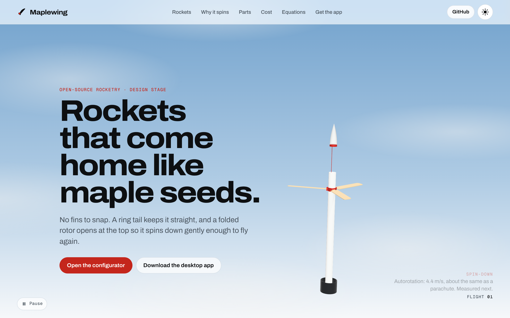
</picture>
</td>
<td width="38%">
<picture>
  <source media="(prefers-color-scheme: dark)" srcset="docs/assets/readme/phone-dark.png">
  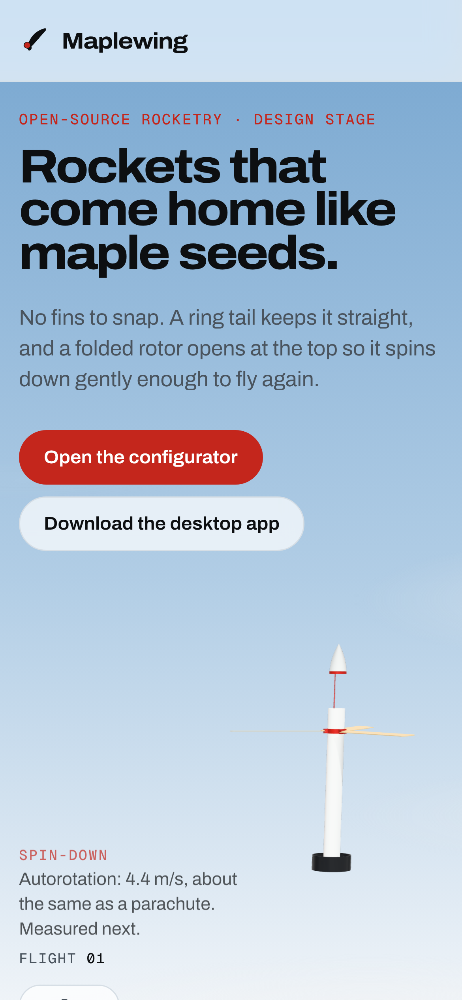
</picture>
</td>
</tr>
</table>

**[normansrule.github.io/maplewing](https://normansrule.github.io/maplewing/)** has the 3D flight, the lineup, a rotor-sizing calculator, every part in a 3D inspector with its STL, the parts lists and the equations. It works in light and dark, on phones, with a keyboard, and respects reduced-motion settings.

<picture>
  <source media="(prefers-color-scheme: dark)" srcset="docs/assets/readme/app-dark.png">
  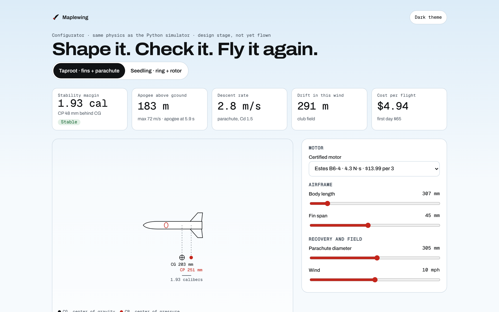
</picture>

**The configurator** lets you pick a certified motor, change the airframe, landing and wind, and see the stability margin, apogee, descent rate, drift and cost per flight update as you go.

- **In the browser:** [normansrule.github.io/maplewing/app](https://normansrule.github.io/maplewing/app/)
- **As a desktop app** for Windows, macOS and Linux, from the [latest release](https://github.com/Normansrule/maplewing/releases/latest). It is the same site, built with [Tauri](https://tauri.app) and bundled so it works offline. Links to other websites open in your browser.

<br>

## Run it yourself

Ubuntu or WSL2 (Windows Subsystem for Linux), Python 3.11 or newer.

```bash
git clone https://github.com/Normansrule/maplewing.git ~/projects/maplewing
cd ~/projects/maplewing
make setup        # .venv with the simulator, tests and chart tools
make test         # Python and browser physics agree; scope rules catch bad designs
make serve        # website at http://localhost:8000
```

| Command | What it does |
|:--|:--|
| `make sim` | Fly the whole lineup again and write `sim/lineup.json` |
| `make site` | Rebuild the website's data, models and configurator from the sim, CAD and parts list |
| `make check` | Export-control guard: fails if any held design appears in a public file |
| `make renders` | Render every part and assembly with three.js in headless Chromium (needs `npm i playwright`) |
| `make charts` | Redraw the README charts from the same data |
| `make shots` | Retake the README screenshots and hero animation (needs Playwright and ffmpeg) |
| `make desktop` | Build the desktop app for this computer (needs Rust and the [Tauri prerequisites](https://tauri.app/start/prerequisites/)) |

<details>
<summary><b>Repository layout</b></summary>

```
maplewing/
├── sim/                 Python simulator: framework, lineup, rotor blade-element model, motor data, tests
├── cad/                 CadQuery parts (maplewing_parts.py), parts.json and the STLs in cad/stl/
├── web/                 Configurator source (built into docs/app/ by tools/build_site.py)
├── docs/                The website, served by GitHub Pages and bundled into the desktop app
│   ├── app/             The configurator, generated
│   ├── data/            site-data.js, generated from sim + CAD + parts list
│   ├── models/          STL copies for the 3D viewer
│   └── assets/          CSS, JavaScript, renders, README images
├── desktop/             Tauri 2 desktop wrapper (Rust)
├── exports/bom/         Parts list with prices, sources and dates
├── notes/               EQUATIONS.md: every equation and assumption
├── tools/               Site build, export guard, renders, charts, screenshots
└── .github/workflows/   CI, Pages deploy, desktop release builds
```

</details>

<br>

## Rules this project keeps

- **Commercial, certified motors only.** No homemade propellant, no energetics, no do-it-yourself pyrotechnics.
- **Passive rockets.** No guidance, no thrust-vector control, nothing that steers.
- **Fly under a club's range safety officer (RSO)**, under NAR or TRA rules, at a field that allows it, and only after ground and drop tests pass.
- **Export control.** The highest tier and the largest Maplewing design are held back for review and are not in this repository. `make check` runs in CI so they cannot slip in.
- **No invented numbers.** Prices have sources and dates. Every simulated number says it is simulated. Assumptions are labelled ASSUMED in the equations.

<br>

## Licence

| What | Licence |
|:--|:--|
| Code: simulator, website, tools, desktop app | [MIT](LICENSES/MIT.txt) |
| CAD, STL files, documentation, data and images | [CC BY-SA 4.0](LICENSES/CC-BY-SA-4.0.txt) |
| Printed circuit boards, when they exist | [CERN-OHL-S 2.0](LICENSES/CERN-OHL-S-2.0.txt) |

Fonts on the website are Archivo and Geist Mono under the SIL Open Font License. three.js and KaTeX are MIT. Thrust curves are from [ThrustCurve.org](https://www.thrustcurve.org).

<div align="center">
<br>
<sub>Built in the open, one drop test at a time.</sub>
</div>
